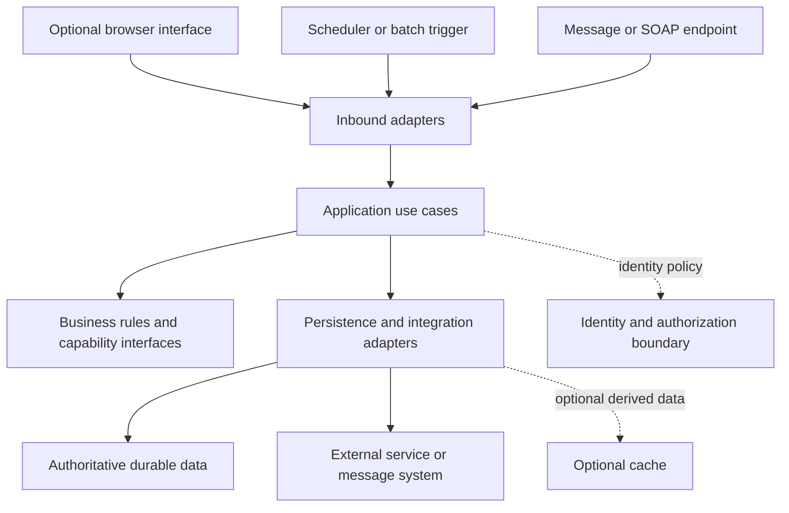

---
{
  "id": "ARC-003",
  "title": "Application and workload reference architecture",
  "type": "guide",
  "status": "draft",
  "revision": 2,
  "owner": "Software Engineering team",
  "classification": "internal",
  "authors": [
    "ai-assisted-drafting"
  ],
  "created": "2026-10-23",
  "updated": "2026-10-28",
  "review_due": "2027-01-23",
  "applicability": {
    "technologies": [],
    "workloads": []
  },
  "required_approvals": [
    "engineering",
    "security"
  ],
  "approvals": [],
  "depends_on": [
    "ARC-002",
    "STD-003",
    "STD-004",
    "STD-005",
    "STD-006",
    "STD-007",
    "STD-008"
  ],
  "requirements": [],
  "requires": [
    "ARC-DESIGN-001",
    "ARC-DESIGN-002",
    "ARC-DESIGN-003",
    "ARC-DESIGN-004",
    "DATA-STORE-001",
    "DATA-STORE-003",
    "IAM-CORE-003",
    "IAM-CORE-002",
    "INT-CONTRACT-004",
    "REL-WORK-003",
    "REL-WORK-006",
    "ARC-DESIGN-005",
    "ARC-DESIGN-006",
    "IAM-CORE-005",
    "INT-CONTRACT-001",
    "INT-CONTRACT-002",
    "INT-CONTRACT-005",
    "REL-WORK-001",
    "REL-WORK-002",
    "REL-WORK-004",
    "REL-WORK-005",
    "REL-WORK-007",
    "OBS-OPER-005",
    "TEST-EVID-001",
    "TEST-EVID-004",
    "IAM-CORE-001",
    "IAM-CORE-004"
  ],
  "supersedes": []
}
---

# Application and workload reference architecture

> Draft for Software Engineering team review. These are proposed requirements and guidance, not an approved standard.

## Purpose and status

This is a candidate logical structure for review, not a deployed system diagram or an approved product selection. It supports a single-process modular application or multiple deployments when justified. Select only the adapters and stores the application needs.

## Logical responsibilities

The arrows show logical use of responsibilities, not required runtime network hops. Interfaces isolate external mechanisms; dependency direction follows ARC-DESIGN-002. A small capability can keep these responsibilities in a compact module rather than generating many empty layers.

| Responsibility | Candidate technology mapping | Application-owned decisions |
| --- | --- | --- |
| Browser presentation | Angular where needed | Session/token architecture, routes, accessibility, API integration |
| Use cases and rules | Java/Spring or Python, according to workload | Capability boundaries, execution model, public interfaces |
| Durable state | PostgreSQL where selected | Dataset ownership, transactions, migrations, recovery |
| Identity provider integration | Keycloak where selected | Trust, realms/clients, token audiences, role mapping |
| Derived state/cache | Valkey only for an explicit use case | Staleness, expiry, failure behavior, rebuilding, sensitive-data scope |
| Message transport | Unselected | Broker, ordering, delivery, replay, ownership |

These mappings reflect technologies in scope, not a requirement for every application to use every product. No supported product version is selected.

## Responsibility map

These are candidate allocations of existing responsibilities, not a mandated application taxonomy, folder tree, or set of deployments. One application can combine several roles in a compact process. Select the roles present in the actual work; workload profiles describe execution/protocol concerns and are a separate dimension. ARC-DESIGN-001 through ARC-DESIGN-004 own capability, dependency, deployment, and effect boundaries.

| Role | Candidate responsibility | Boundary and decision to review |
| --- | --- | --- |
| Frontend application | Presentation, interaction, accessibility, local workflow state, and contract adaptation | Distinguish client feedback from authoritative business decisions; identify server authorization and the selected session model. A frontend does not imply a BFF, cache, or background job. |
| BFF, when justified | Client-specific API adaptation/aggregation and browser session/token mediation where selected | Identify its own protected entry points and downstream authority. Keep reusable business invariants with their capability owner rather than duplicating them for one UI. If it owns a business capability, name that additional responsibility explicitly. |
| Business REST API | Expose capability use cases and contracts; enforce resource authorization and owned invariants; define effects and completion | Distinguish domain behavior from HTTP translation. An API can be a single module or a deployment; neither a BFF nor a database is automatically required. |
| Integration adapter or service | Translate an external contract, identity context, representation, and failure behavior into an internal use-case boundary | Name external contract ownership, mapping rules, and compatibility constraints. Keep partner-specific mechanics in adapters; locate business orchestration explicitly. Integration can be an in-process adapter or a justified service. |
| Standalone processor or CLI | Compose an execution entry point, invoke use cases, own resources, and report truthful outcomes | Identify finite versus continuous execution, admission/cancellation, authority, state, and effects. Select batch, scheduler, consumer, REST, or SOAP profiles only when their actual scopes match. |
| Scheduler | Determine when an operation should be initiated and identify its business window/run | Keep scheduling policy distinct from business processing; identify missed/duplicate triggers, overlap, execution authority, and whether invocation itself durably transfers work. |
| Batch processor | Process a defined input set with bounded units, item outcomes, and end-of-run reconciliation | Identify input version, checkpoint/effect boundaries, rejected items, and restart versus intentional rerun. Finite processing can be small; restart needs follow its real duration and loss tolerance. |
| Message consumer | Adapt delivery into an authorized use case; manage acknowledgment, concurrency, and failure disposition | Identify operation identity, ordering scope, durable effects, poison handling, and replay. Receiving a message does not establish user delegation or completed business work. |

A BFF's browser/session design follows IAM-CORE-004; business resource authorization remains governed by IAM-CORE-002. A trusted downstream arrangement still needs explicit identity, assertion validation, and delegation design under IAM-CORE-001, IAM-CORE-003, and IAM-CORE-005; forwarding a username or role is not enough. Do not add a second independent copy of a business permission rule merely because there is an extra HTTP hop. Identify which boundary enforces each rule and what authenticated context reaches it.

## Boundary decisions

Capability decomposition uses ARC-DESIGN-001; deployment choice uses ARC-DESIGN-003. Inbound adapters handle protocol translation; application use cases coordinate decisions and side effects. State ownership follows DATA-STORE-001, and transactions follow DATA-STORE-003. Authentication/assertion validation and resource authorization use IAM-CORE-003 and IAM-CORE-002. Do not infer trust from the diagram's proximity or network placement.

## Application structure and ownership

Begin with capability ownership and externally visible behavior, then identify the mechanisms that can change independently. A public capability interface is an interaction contract, not necessarily a network API or an interface for every class. Business rules can be exercised without the chosen transport or store under ARC-DESIGN-002. Use the Java, Spring, or Python conventions for language/framework details only where selected.

Keep the application composition and lifecycle visible: entry points, configuration, owned clients/resources, execution capacity, and shutdown. Small applications can keep these responsibilities together with deliberate boundaries; larger ones can separate modules or deployments where ARC-DESIGN-003 justifies that cost. Record deployment ownership and failure implications rather than inferring them from a diagram or package layout.

For state, distinguish authoritative business data, durable work intent/progress, session state, derived cache data, and ephemeral process/UI state. They need different loss, retention, consistency, and recovery analysis. DATA-STORE-001 owns durable dataset boundaries; ARC-DESIGN-004 owns side-effect boundaries. A database, cache, identity provider, or broker is selected to meet actual needs, not to complete the diagram.

## Synchronous execution

A request passes bounded ingress, identity checks where protected, contract validation, resource authorization, use-case execution, and result translation. The [REST request pattern](../../patterns/application/rest-request-pipeline.md) shows one candidate ordering. Completion is described according to ARC-DESIGN-004 and INT-CONTRACT-004 rather than inferred from an HTTP success response.

## Background execution

A trigger identifies work, establishes execution authority, and invokes a bounded unit. Identify durable progress and effect records where the actual restart, acceptance, or business contract requires them; a stateless local calculation does not automatically need a work repository. For durable effects or handoffs, record the required outcome before claiming acknowledgment/completion. The [recoverable work pattern](../../patterns/integration/durable-work-receipts.md) explores REL-WORK-003 and REL-WORK-006. Schedulers, batches, and consumers differ in trigger and progress semantics; they share use-case logic where business behavior is the same.

## External effects and integration boundaries

INT-CONTRACT-001, INT-CONTRACT-002, and INT-CONTRACT-005 own interface, compatibility, and representation obligations. At a partner boundary, identify which schema is externally controlled, which internal capability owns the meaning, and where mapping/rejection occurs. Review nulls, identifiers, time, units, and errors without treating a generated transport type as the internal domain model. These responsibilities apply to SOAP, REST, messages, and file exchange as relevant.

Separate a local transaction's outcome from a remote operation's outcome. REL-WORK-002, REL-WORK-003, and REL-WORK-006 govern ambiguous retries, operation identity, and durable handoff. A timeout after a remote request may need reconciliation; a local rollback does not prove the remote action was undone. Identify the party that can authoritatively determine the outcome and the authorized recovery action. When the partner provides no safe deduplication or reconciliation contract, record that limitation and seek a decision before promising safe automatic retry.

An outbox, receipt, checkpoint, or compensation process may be a suitable approach only within its reviewed assumptions. The existing durable-receipt candidate covers effects recorded atomically in one PostgreSQL transaction and describes a possible downstream handoff. It is not an approved general distributed-workflow implementation. A recovery mechanism for a distinct external-effect boundary needs its own evidence before pattern approval.

## Operating responsibilities

ARC-DESIGN-005 connects workload objectives to infrastructure choices; REL-WORK-001 and REL-WORK-007 connect capacity, shutdown, and recovery. OBS-OPER-005 owns accountable investigation and runbook needs. In application documentation, identify who owns application behavior, runtime configuration, dependency operation, access changes, deployment, and restoration. A shared platform can supply evidence for its stated responsibility without proving the application's integration or business outcome.

Review the boundary with the actual operating owner: who detects failure, knows the committed outcome, can authorize replay or correction, and verifies recovery? Record unresolved platform arrangements explicitly. This manual does not assume a separate platform team or assign a runtime product to every application.

## Representative review walkthroughs

These synthetic walkthroughs test responsibility allocation and reading paths. They select no products, deployment topology, session design, or production configuration. Use TEST-EVID-001 and TEST-EVID-004 for actual evidence and failure coverage; no runtime results are claimed here.

| Situation | Trace and source priorities | Clarification or evidence boundary |
| --- | --- | --- |
| Frontend + BFF + business REST API | Trace one interaction through presentation, any session mediation, business authorization, use-case effects, and response translation. Read the REST profile, actual technology conventions, identity, and contracts. | Identify session and downstream trust decisions, capability ownership, and accepted versus completed state. The bearer-token validation-job fixture cannot settle the session model. |
| Backend processor with no browser | Trace initiation, input/configuration validation, execution authority, rule evaluation, relevant effects, truthful process outcome, and shutdown. Read actual language conventions, shared security/reliability/observability/delivery; select profiles only for matching behavior. | If no specialized profile matches, use the reviewed no-match route. Establish evidence for actual resources and effects without inventing an HTTP endpoint, database, or queue. |
| Scheduled or restartable batch | Trace a business window and input version through triggering, bounded units, committed effects/checkpoints, restart, and reconciliation. Read scheduler/batch profiles and REL-WORK-004 and REL-WORK-005. | Identify duplicate/missed triggers, overlap, interrupted chunks, changed input, and rejected records. A short same-transaction job does not establish general checkpoint or long-running lease correctness. |
| Integration service or message consumer | Trace the external contract and identity context into a use case, local/remote effects, acknowledgment, and replay. Read the matching SOAP/REST/consumer profiles, contracts, identity, and REL-WORK-002, REL-WORK-003, and REL-WORK-006. | Distinguish delivery identity from business operation identity; expose uncertain remote outcomes and ordering assumptions. A database receipt cannot prove the outcome of an unrelated partner effect. |

For each walkthrough, report the responsible actor/component, actual governing IDs, open decisions, conditional exclusions, and evidence still required. The application supplies its own diagrams and ADRs under ARC-DESIGN-006. This is a discovery exercise, not an application migration plan.

## Optional cache

A candidate use of Valkey is rebuilding derived read data from an authoritative source. This proposal does not treat a cache entry as proof a business effect completed or as a universally safe distributed lock. Valkey documents asynchronous replication; required durability and failover semantics therefore need explicit analysis. [Valkey replication](https://valkey.io/topics/replication/).

## Review evidence and open choices

Walk through representative success and failure behavior for the application's actual responsibilities using synthetic data. Use a request and an interrupted job when those behaviors exist. Identify trust transitions, authoritative state, commit boundaries, time budgets, and recovery ownership. Review service objectives, browser architecture, deployment, supported versions, and broker/cache use cases before adopting an application-specific topology. The application supplies actual diagrams and ADRs; this central document remains reusable.
