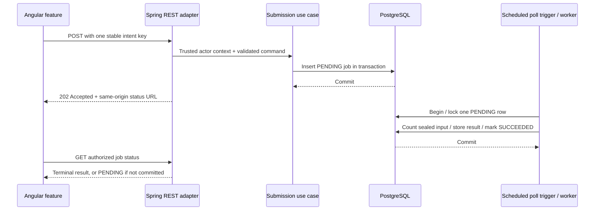

---
{
  "id": "ARC-004",
  "title": "Worked REST and background validation job",
  "type": "guide",
  "status": "draft",
  "revision": 1,
  "owner": "Software Engineering team",
  "classification": "internal",
  "authors": [
    "ai-assisted-drafting"
  ],
  "created": "2026-10-23",
  "updated": "2026-10-23",
  "review_due": "2027-01-23",
  "applicability": {
    "technologies": [
      "java",
      "spring",
      "angular",
      "postgresql"
    ],
    "workloads": [
      "rest-api",
      "scheduler"
    ]
  },
  "required_approvals": [
    "engineering",
    "security"
  ],
  "approvals": [],
  "depends_on": [
    "ARC-003",
    "PAT-004",
    "STD-003",
    "TECH-009",
    "STD-005",
    "STD-006",
    "TECH-008",
    "ARC-002",
    "STD-004",
    "STD-008",
    "TECH-010"
  ],
  "requirements": [],
  "requires": [
    "IAM-CORE-003",
    "SPRING-APP-005",
    "IAM-CORE-002",
    "INT-CONTRACT-001",
    "INT-CONTRACT-004",
    "REL-WORK-003",
    "REL-WORK-001",
    "JAVA-CODE-002",
    "JAVA-CODE-005",
    "ARC-DESIGN-002",
    "SPRING-APP-004",
    "INT-CONTRACT-003",
    "SPRING-APP-003",
    "DATA-STORE-003",
    "DATA-STORE-004",
    "SPRING-APP-006",
    "REL-WORK-007",
    "SPRING-APP-007",
    "TEST-EVID-003",
    "ANG-APP-002",
    "ANG-APP-004",
    "ANG-APP-006",
    "TEST-EVID-001"
  ],
  "supersedes": []
}
---

# Worked REST and background validation job

> Draft for Software Engineering team review. Proposed guidance; no formal approval or runtime certification is implied.

## Purpose and boundaries

This is a synthetic end-to-end design for reviewing how shared standards translate into implementation. It is reusable central reference material, not an application's approved architecture. A user submits validation of an immutable synthetic dataset; a short worker counts total/invalid flags; Angular shows the durable outcome. It exercises REST and scheduled background execution without introducing a broker, cache, external effect, or long-running lease.

The [source pack](../../examples/validation-job/README.md) contains an OpenAPI contract, synthetic JSON examples, SQL sketches, a structural artifact check, and an unexecuted runtime verification plan. These artifacts are not a runnable Java/Angular application. Runtime versions and application evidence remain pending.

## Candidate logical structure



The worker executes under its application workload identity. It does not retain the user's access token. The database input is sealed/immutable for its version and limited to 1,000 synthetic items by the reference item-number domain. These limits and topology are example choices, not universal team defaults.

## Contract and authorization

The [contract](../../examples/validation-job/openapi.json) defines POST /v1/validation-jobs and GET /v1/validation-jobs/{jobId}. The example assumes a bearer-token API, but this does not settle the organization's browser/BFF decision. IAM-CORE-003 and SPRING-APP-005 own token/security-chain verification; IAM-CORE-002 owns resource authorization.

The server resolves tenant and actor from validated internal principal context. Neither appears in the creation body. The example's resource policy permits a principal to read its own jobs in its tenant; extra sharing/operator permissions require a separate reviewed policy. A guessed job ID is not authorization. The status SQL includes tenant, actor, and job ID in the same query and has no unscoped fallback.

## One intent and duplicate submissions

An operation key is stable for one immutable request. Its scope is tenant, actor, and this submission operation. The server fingerprints normalized input using the exact UTF-8 bytes:

```text
validate-dataset\n<datasetId>\n<datasetVersion-as-canonical-decimal>\n
```

A new committed job returns 202 with PENDING state. Repeating the same scoped key and same fingerprint returns 200 with that same job's current representation. A different fingerprint with the same key returns a 409 conflict. This is the example's INT-CONTRACT-001/INT-CONTRACT-004 contract implementing REL-WORK-003; it does not promise byte-identical responses forever.

At READ COMMITTED, an insert losing a concurrent uniqueness race is followed by a separate scoped lookup statement. That statement can observe a newly committed winner; an unexamined single-snapshot insert/select CTE may not. [PostgreSQL Read Committed behavior](https://www.postgresql.org/docs/18/transaction-iso.html) explains the snapshot difference. The caller compares the fingerprint and rechecks authorization before exposing a prior result. Retention of intent records must cover the retry/replay horizon; this fixture does not implement deletion.

## Submission, worker, and terminal outcomes

The API reports acceptance only after its insert transaction commits. A network/commit ambiguity leaves the client outcome unknown; retrying the same immutable intent/key is safer than manufacturing a second key. Admission quotas and time budgets use REL-WORK-001 but their production values are not selected here.

The [short-work pattern](../../patterns/operations/short-database-work-queue.md) keeps claim, aggregate result, and terminal state in one transaction. There is no separate committed RUNNING claim. PENDING can therefore include work active inside that transaction. SUCCEEDED means the validation ran; a result with invalidCount greater than zero is still successful execution, not proof every record was valid. FAILED is an explicitly investigated terminal failure, not the meaning of a temporary GET error.

The worker retries only classified transient failures within a configured attempt/time budget. On an unclassified/permanent error or an exhausted budget, it rolls back and stops polling for intervention. The fixture does not implement durable retries, per-item checkpoints, broker redelivery, or external side effects. The operator failure sketch uses a guarded state change plus audit insert and cannot overwrite an already terminal row.

## Java and Spring mapping

| Responsibility | Candidate implementation location | Source IDs |
| --- | --- | --- |
| Input values, result, state meaning | Java domain/application types | JAVA-CODE-002, JAVA-CODE-005 |
| Submission and status policy | Application use cases | ARC-DESIGN-002, IAM-CORE-002 |
| HTTP binding and safe errors | Spring web adapter and advice | SPRING-APP-004, INT-CONTRACT-003 |
| Managed transaction boundary | Submission service and separate worker service | SPRING-APP-003, DATA-STORE-003 |
| SQL statements and row mapping | SQL persistence adapter | DATA-STORE-004 |
| Poll trigger and failures | Thin scheduler + owned worker capacity | SPRING-APP-006, REL-WORK-007 |
| Commit/worker integration tests | Real database and managed beans | SPRING-APP-007, TEST-EVID-003 |

The scheduling adapter calls a separate managed worker entry point through the configured proxy. A same-instance call to an annotated method is not assumed to establish the transaction. Do not start processing from a test-managed uncommitted insertion and treat invisibility to another connection as a working production flow.

## Angular state and recovery

The feature separates a typed HTTP boundary, local workflow state, and rendered status. ANG-APP-002 and ANG-APP-004 govern state and lifecycle. The client owns an immutable request/key for a submission attempt, then owns polling for the accepted job.

| UI observation | Candidate behavior |
| --- | --- |
| User initiates one validation | Allocate one intent key and preserve the immutable input |
| 202 or authorized 200 replay | Display current job; poll if PENDING |
| Submission response lost | Show outcome unknown; offer bounded retry of the same input/key |
| 409 key/input conflict | Explain the intent conflict; do not silently submit a new intent |
| Status GET fails temporarily | Keep the known job and display a retrieval problem, not FAILED execution |
| SUCCEEDED with invalid records | Show completion and the invalid count distinctly |
| FAILED | Show safe failure category and permitted next action |
| Navigation or selection changes | Stop/replace owned polling; ignore obsolete responses |

Poll destinations stay inside the configured trusted API boundary under ANG-APP-006. Leaving the feature or unsubscribing does not cancel an accepted job. Poll timing respects server hints within a bounded client policy. No production interval, automatic mutation-retry count, or browser token persistence choice is selected.

## Verification plan and current evidence

Use the [scenario matrix](../../examples/validation-job/VERIFICATION.md) to check new/repeated/conflicting submissions, cross-resource access, two workers, rollback/crash timing, stale UI responses, and operator races. Assert durable effects, not only HTTP status. Requirements for representative evidence are owned by TEST-EVID-001 and TEST-EVID-003.

Document structure, references, and JSON artifact structure can be checked locally. Java/Spring/Angular compilation, full OpenAPI validation, PostgreSQL execution, and security/concurrency behavior are not yet verified. No pattern approval or application compliance claim follows from this worked design.

## Choices needed before a pilot

Select supported product versions, build/persistence/migration tools, trusted identity/tenant mapping, browser/session design, service objectives, roles, immutable input controls, admission limits, retry budgets, and a pilot application repository. Then implement and execute the scenario matrix before promoting the pattern. The [roadmap](../../governance/implementation-roadmap.md) records remaining organization decisions.
