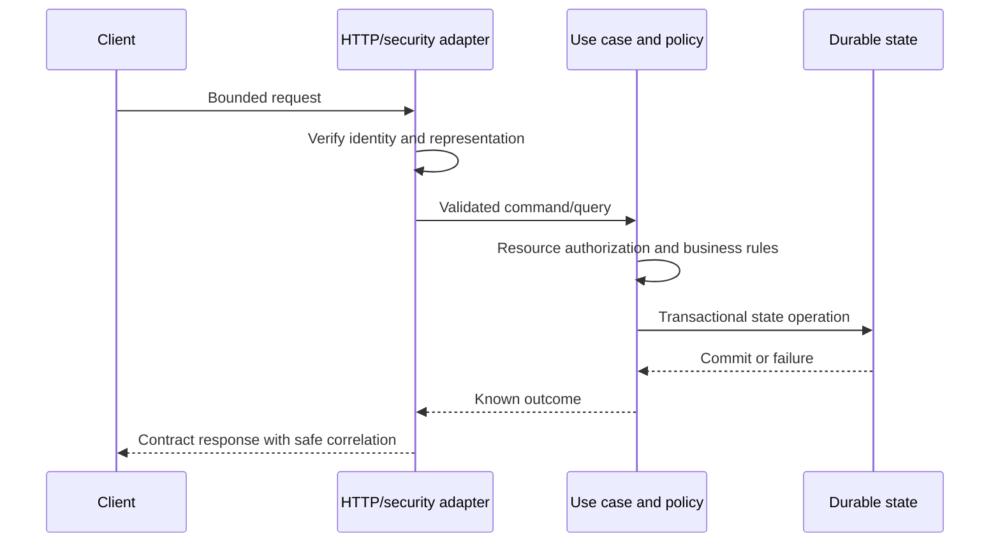

---
{
  "id": "PAT-003",
  "title": "REST request processing pipeline",
  "type": "implementation-pattern",
  "status": "draft",
  "revision": 1,
  "owner": "Software Engineering team",
  "classification": "internal",
  "authors": [
    "ai-assisted-drafting"
  ],
  "created": "2026-10-23",
  "updated": "2026-10-23",
  "review_due": "2027-01-23",
  "applicability": {
    "technologies": [],
    "workloads": [
      "rest-api"
    ]
  },
  "required_approvals": [
    "engineering",
    "security"
  ],
  "approvals": [],
  "depends_on": [
    "ARC-002",
    "STD-002",
    "STD-003",
    "STD-004",
    "STD-005",
    "STD-006",
    "STD-007"
  ],
  "requirements": [],
  "requires": [
    "ARC-DESIGN-002",
    "ARC-DESIGN-004",
    "SEC-BASE-002",
    "SEC-BASE-007",
    "IAM-CORE-002",
    "IAM-CORE-003",
    "IAM-CORE-004",
    "INT-CONTRACT-004",
    "DATA-STORE-003",
    "REL-WORK-003",
    "OBS-OPER-001"
  ],
  "supersedes": []
}
---

# REST request processing pipeline

> Draft for Software Engineering team review. These are proposed requirements and guidance, not an approved standard.

## Applicability and status

Candidate organization of a REST request in Java/Spring or Python, optionally called by Angular. This draft illustrates boundaries without prescribing a framework version, token storage design, controller API, ORM, or deployable topology. It has no verified reference implementation yet.

## Requirements addressed

ARC-DESIGN-002 and ARC-DESIGN-004 establish separation and side-effect boundaries. Security, identity, contract, transaction, and reliability obligations remain in their source standards: SEC-BASE-002, SEC-BASE-007, IAM-CORE-002, IAM-CORE-003, INT-CONTRACT-004, DATA-STORE-003, and REL-WORK-003.

## Candidate sequence

1. The ingress boundary applies request-size/time limits and establishes safe correlation before expensive work.
2. For protected operations, maintained framework security validates the presented identity using configured trust. The API does not treat a browser-supplied role or gateway header as authority without an authenticated trust arrangement.
3. A transport adapter parses a contract-specific request model, validates representation, and translates it into a use-case command/query. Persistence entities are not automatically the request/response contract.
4. The use case authorizes the actual resource and action, applies business rules, and establishes a transaction where needed. Resource authorization remains valid at the relevant state-change boundary; a preliminary route check alone may be insufficient.
5. Persistence/integration adapters implement the defined side-effect plan. Retryable commands use their reviewed duplicate-handling design. If work is only durably accepted for later execution, the result remains accepted/pending rather than falsely completed.
6. The adapter translates the known outcome into the HTTP contract and a safe body. Error mapping preserves expected categories and safe correlation. OBS-OPER-001 connects the safe operational trace.

The diagram omits optional external effects. An external call requires its own timeout, ambiguity, and reconciliation design; drawing it between begin and commit does not make it atomic.

## Responsibility mapping

| Concern | Candidate location |
| --- | --- |
| HTTP representation and status mapping | Inbound adapter |
| Token verification and trusted principal | Framework security boundary |
| Resource/action decision | Application policy/use case with domain context |
| Business invariant | Business rules |
| SQL and persistence mechanics | Persistence adapter |
| Retry/deduplication boundary | The use case/integration boundary that owns the operation |

## Verification before approval

Exercise valid input, malformed/oversized requests, unauthenticated access, cross-user resource access, concurrency conflicts, repeated commands, dependency timeouts, and commit-then-disconnect. Check business effects and disclosure, not only HTTP status. Compare contract behavior through a representative independent client.

## Alternatives and remaining decisions

A simple read may use fewer abstractions while preserving the same responsibilities. Streaming endpoints and long-running operations need different capacity/completion handling. Decide browser session/BFF versus token client explicitly; IAM-CORE-004 owns that review. A framework-specific example and integration tests are the next evidence required.
