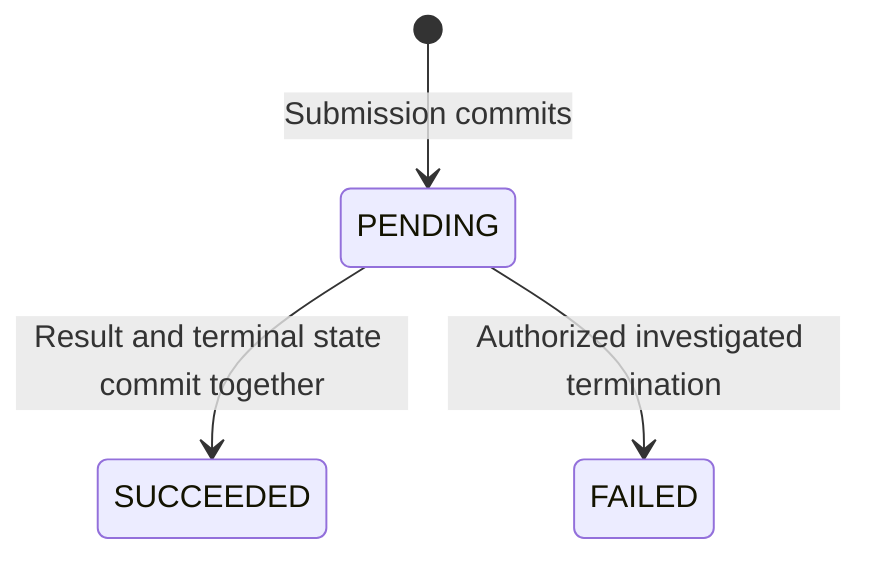

---
{
  "id": "PAT-004",
  "title": "Short database-owned background work",
  "type": "implementation-pattern",
  "status": "draft",
  "revision": 1,
  "owner": "Software Engineering team",
  "classification": "internal",
  "authors": [
    "ai-assisted-drafting"
  ],
  "created": "2026-10-23",
  "updated": "2026-10-23",
  "review_due": "2027-01-23",
  "applicability": {
    "technologies": [
      "postgresql"
    ],
    "workloads": []
  },
  "required_approvals": [
    "engineering",
    "security"
  ],
  "approvals": [],
  "depends_on": [
    "STD-004",
    "STD-006"
  ],
  "requirements": [],
  "requires": [
    "DATA-STORE-001",
    "DATA-STORE-003",
    "REL-WORK-001",
    "REL-WORK-003",
    "REL-WORK-004",
    "REL-WORK-006"
  ],
  "supersedes": []
}
---

# Short database-owned background work

> Draft for Software Engineering team review. Proposed guidance; no formal approval or runtime certification is implied.

## Applicability and status

Candidate for short, bounded work whose input, result, and terminal job transition can be handled in one PostgreSQL transaction. It fits a small internal asynchronous workload without selecting a message broker. It is not an organization-wide queue recommendation and has not been executed against PostgreSQL in this environment.

## Requirements addressed

Use DATA-STORE-001 and DATA-STORE-003 for durable invariants and transactions, REL-WORK-001 for capacity/time budgets, REL-WORK-003 for duplicate effects, REL-WORK-004 for competing workers, and REL-WORK-006 for durable acceptance. The [worked validation-job example](../../architecture/reference-architectures/validation-job-example.md) connects this candidate to an HTTP producer and UI.

## Candidate boundaries

The submission transaction stores one PENDING job with an operation identity before the API reports durable acceptance. The job row acts as the durable intent record; a process-local async task does not replace it. A scoped uniqueness constraint prevents duplicate submission rows.

A worker starts a short transaction, selects one eligible job with a row lock, performs bounded database-owned work, records the result, and changes the state to SUCCEEDED before committing. The lock is held across that entire unit. Other workers skip locked rows; they do not commit a claim and later pretend the released lock still owns the job.

PENDING means not durably terminal; a worker may be active inside an uncommitted transaction. This candidate deliberately has no externally visible RUNNING/progress state, lease, or automatic cancellation.

## What the row lock proves

PostgreSQL describes SKIP LOCKED as useful for queue-like competing consumers, while warning that it provides an inconsistent view for ordinary queries. It avoids waiting on a claimed row; it does not establish strict FIFO ordering, fairness, absence of table-level waits, or global exactly-once delivery. [PostgreSQL SELECT locking](https://www.postgresql.org/docs/18/sql-select.html).

## Failure behavior

| Point | Candidate outcome |
| --- | --- |
| Submission rolls back | No accepted job exists |
| Submission commits, response is lost | An authorized replay of the same intent key finds the same job |
| Worker dies before commit | Result/state changes roll back and the lock is released; the job remains PENDING |
| Worker commits, then dies | A subsequent worker sees a terminal job and does not process it again |
| Unexpected/permanent worker failure | Roll back, stop automatic polling, and request intervention |
| Transient failure exceeds its configured retry budget | Stop automatic polling rather than retrying poison work forever |

The minimal example has no durable attempt counter or general poison-work service. An authorized operator investigates PENDING work and may mark it FAILED with safe audit evidence. After a correction, restarting the worker is a deliberate operational action. A multi-worker retry policy needs review so each instance does not create an uncontrolled retry storm.

## Limits and alternatives

Do not hold this transaction open for remote calls, long computation, or unbounded input. Those cases need a different design, such as durable claims with leases/fencing, chunk checkpoints, a reviewed outbox/consumer arrangement, or a purpose-built broker. A cache lock is not a replacement for the stated transaction boundary. Row locking alone does not solve end-to-end effect ownership outside the database.

## Verification before approval

Execute two competing workers, process death before/after commit, rolled-back result writes, transaction timeouts, an exhausted retry budget, and an operator/worker race. Check durable business results and row state. Validate actual role permissions and immutable input assumptions. Runtime verification remains pending; the SQL artifacts are a design fixture.
